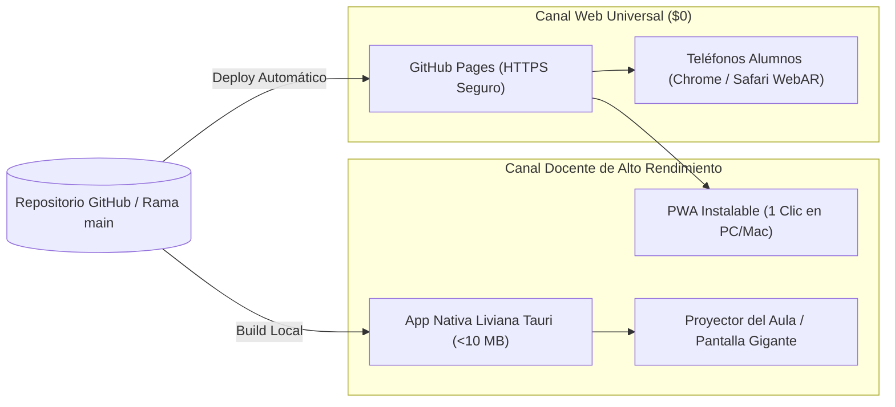

# 🌌 VirtualLab_N: Documento Maestro de Arquitectura, Roadmap y Ecosistema de Prompts
> **Plataforma Educativa de Física y Computación Cuántica en WebAR y Escritorio**  
> **Estilo Natex | $0 USD Cost | Sincronización Maestro-Alumno | Prompts de IA para Profesores y Estudiantes**

---

## 📑 Índice General
1. [Visión, Identidad y Filosofía de Costo Cero ($0)](#1-visión-identidad-y-filosofía-de-costo-cero-0)
2. [Sistema de Diseño Visual "Estilo Natex"](#2-sistema-de-diseño-visual-estilo-natex)
3. [Panel Maestro del Docente y Vista del Estudiante](#3-panel-maestro-del-docente-y-vista-del-estudiante)
4. [Módulo de Evaluación Formativa y Exportador Excel / CSV](#4-módulo-de-evaluación-formativa-y-exportador-excel--csv)
5. [Base de Datos de Componentes 3D Reutilizables (`/assets/components/`)](#5-base-de-datos-de-componentes-3d-reutilizables-assetscomponents)
6. [Catálogo Maestro de 35 Experimentos Nucleares (350 Preguntas)](#6-catálogo-maestro-de-35-experimentos-nucleares-350-preguntas)
7. [Módulo Especial: Visor Holográfico de Funciones 3D y Campos Escalares en Tiempo Real](#7-módulo-especial-visor-holográfico-de-funciones-3d-y-campos-escalares-en-tiempo-real)
8. [Batería de Prompts Listos para Copiar y Pegar](#8-batería-de-prompts-listos-para-copiar-y-pegar)
   * 8.1. [Prompt Maestro para Profesores: Crear Nuevos Experimentos con IA](#81-prompt-maestro-para-profesores-crear-nuevos-experimentos-con-ia)
   * 8.2. [Prompts y Fichas de Indagación Científica para Estudiantes](#82-prompts-y-fichas-de-indagación-científica-para-estudiantes)
   * 8.3. [Prompts del Sistema Jefe-Trabajador (Argon y los 5 Auditores Flash 3.8)](#83-prompts-del-sistema-jefe-trabajador-argon-y-los-5-auditores-flash-38)
9. [Arquitectura de Despliegue Dual (WebAR GitHub Pages + App de Escritorio)](#9-arquitectura-de-despliegue-dual-webar-github-pages--app-de-escritorio)
10. [Reglas de Oro de Optimización de Tokens y Limpieza de Repositorio](#10-reglas-de-oro-de-optimización-de-tokens-y-limpieza-de-repositorio)

---

## 1. Visión, Identidad y Filosofía de Costo Cero ($0)

**VirtualLab_N** es una plataforma científica de código abierto diseñada para transformar cualquier mesa de aula escolar, laboratorio universitario o atril de conferencias en un entorno interactivo tridimensional.

### Principios Fundamentales
* **Cero Costo ($0.00 USD permanentes):** Sin servidores de pago, sin suscripciones, sin cuotas de Apple Developer ($99) ni licencias de software privativo.
* **Cero Instalación para Alumnos:** Corre en el navegador móvil (Chrome en Android, Safari en iOS) gracias a WebAR (MindAR.js) anclado a un marcador de papel impreso.
* **Fidelidad Física Absoluta:** Cálculos matemáticos basados en integradores numéricos Runge-Kutta de 4º orden (RK4) y Verlet, respetando rigurosamente las leyes de conservación de energía y momento.
* **Presencia del Autor:** La interfaz del profesor integra un enlace permanente, visible y estilizado al perfil de GitHub del creador (`github.com/tu-usuario/VirtualLab_N`).

---

## 2. Sistema de Diseño Visual "Estilo Natex" y Marcador AR

El **Estilo Natex** define una estética sobria, oscura, científica y funcional, inspirada en las interfaces HUD de laboratorios espaciales y consolas de telemetría militar de alta precisión.

```
       PALETA DE COLORES "ESTILO NATEX"
┌───────────────────────────────┬────────────┐
│ Color                         │ Hex        │ Uso Principal
├───────────────────────────────┼────────────┤
│ Natex Dark Void (Fondo)       │ #07090e    │ Fondo global y paneles
│ Natex Panel Slate             │ #0f141c    │ Tarjetas y modales
│ Natex Border Cyan             │ #1e293b    │ Bordes sutiles y divisores
│ Natex Cyan Glow (Acento 1)    │ #00f2fe    │ Vectores de velocidad / Enlaces
│ Natex Electric Blue (Acento 2)│ #4facfe    │ Vectores de fuerza / Primario
│ Natex Neon Green (Éxito)      │ #10b981    │ Respuestas correctas / Play
│ Natex Amber Warning (Calor)   │ #f59e0b    │ Energía térmica / Alertas
│ Natex Quantum Purple          │ #8b5cf6    │ Fenómenos cuánticos / Qubits
│ Natex Text Primary            │ #f8fafc    │ Títulos y números clave
│ Natex Text Muted              │ #94a3b8    │ Subtítulos y fórmulas
└───────────────────────────────┴────────────┘
```

### 2.1. Especificación del Marcador AR Físico: "Diana Geométrica Multi-Anchor"

Para garantizar un anclaje 3D de grado industrial que no tiemble (*cero jitter*) y tolere que los alumnos tapen partes de la hoja con sus manos o lápices, el marcador físico adopta un sistema de **Constelación Asimétrica de 4 Esquinas**:

```
┌─────────────────────────────────────────────────────────────┐
│   [ ◯ ] Círculo (Con punto focal ⊙)         [ △ ] Triángulo │
│   (Esquina Superior Izquierda)      (Esquina Superior Dcha) │
│                                                             │
│                                                             │
│                        ┌───────────┐                        │
│                        │  TU LOGO  │                        │
│                        │  CENTRAL  │                        │
│                        └───────────┘                        │
│                                                             │
│   [ ◇ ] Diamante                            [ □ ] Cuadrado  │
│   + QR de acceso web                (Esquina Inferior Dcha) │
│   (Esquina Inferior Izquierda)                              │
└─────────────────────────────────────────────────────────────┘
```

#### Ventajas Técnicas y Pedagógicas:
1. **Asimetría Topológica Total (Cero Inversión):**
   * Cada esquina tiene una firma geométrica única: Círculo (0 vértices), Triángulo (3 vértices a $60^\circ$), Diamante (4 vértices inclinados a $45^\circ$) y Cuadrado (4 vértices ortogonales a $90^\circ$).
   * El algoritmo de visión artificial determina la orientación espacial de la mesa en milisegundos; es físicamente imposible que la simulación se invierta o aparezca de cabeza.
2. **Triangulación de Base Ancha (Anti-Tembleque):**
   * Al estar los anclajes distribuidos en los 4 extremos de la hoja A4 (>20 cm de separación), la palanca matemática de cálculo de perspectiva elimina por completo las vibraciones y el temblor de la cámara móvil.
3. **Resistencia a Oclusiones Parciales:**
   * Si un estudiante apoya su mano o su cuaderno sobre el logo central, la cámara mantiene el experimento vivo apoyándose en las 4 esquinas. Si tapa una esquina, las otras 3 más el logo preservan la posición.
4. **Instrucción Docente Instantánea:**
   * El profesor alinea a todo el curso en 5 segundos con una instrucción universal: *"Coloquen la hoja en el banco con el **Triángulo** apuntando hacia la pizarra"*.
5. **Formato Imprimible:**
   * Vectorial monocromático (`marcador.svg` / `marcador.png`), 100% apto para fotocopias estándar en blanco y negro sin coste de tinta color.

### 2.2. Reglas de Renderizado y HUD 3D:
1. **Tipografía:**
   * Títulos e indicadores numéricos: `'JetBrains Mono'`, `'Fira Code'` o monospace equivalente.
   * Texto de lectura y guías: `'Inter'`, `'system-ui'`.
2. **Paneles HUD Flotantes:**
   * Fondo translúcido con desenfoque de fondo (`backdrop-filter: blur(12px); background: rgba(15, 20, 28, 0.85);`).
   * Bordes delgados de 1px con brillo sutil cian (`border: 1px solid rgba(0, 242, 254, 0.2);`).
3. **Vectores Tridimensionales en Realidad Aumentada:**
   * Flecha de Velocidad $\vec{v}$: Color `#00f2fe` (Cian brillante).
   * Flecha de Fuerza / Tensión $\vec{F}$: Color `#4facfe` (Azul eléctrico).
   * Flecha de Aceleración $\vec{a}$: Color `#f43f5e` (Rosa neón).
   * Líneas de Campo Magnético $\vec{B}$: Color `#10b981` (Verde esmeralda).
   * Líneas de Campo Eléctrico $\vec{E}$: Color `#eab308` (Ámbar dorado).

---

## 3. Panel Maestro del Docente y Vista del Estudiante

### A. Panel del Profesor (Pantalla de Control Maestro)
* **Barra Superior (Navbar):**
  * Logotipo `VirtualLab_N` con indicador de estado WebSockets en vivo (punto verde pulsante: *"Sala Activa: 32 alumnos conectados"*).
  * Selector desplegable de los 33 experimentos con buscador instantáneo por palabra clave.
  * Botón directo con icono de GitHub: **"Creado por [Tu Nombre] • Ver en GitHub"** (enlace directo a tu repositorio).
  * Botón *"Generar Guía de Clase en PDF"*: genera una hoja A4 lista para imprimir con el QR, el marcador de la mesa y la guía de preguntas.
* **Área de Simulación Central (Espejo 3D):**
  * Render Three.js en vivo que replica exactamente lo que ven los alumnos en sus mesas.
  * Barra de transporte: `Play`, `Pausa`, `Frame Forward` (avance paso a paso de 1 fotograma para analizar colisiones o saltos cuánticos), `Cámara Lenta` ($0.1\times, 0.25\times, 0.5\times, 1\times, 2\times$), y `Reset`.
* **Dock Lateral de Parámetros:**
  * Sliders reactivos con input numérico directo para cada variable física.
  * Switch: *"Desbloquear Modo Sandbox en Alumnos"* (permite a los alumnos manipular controles en sus teléfonos cuando el profesor lo autoriza).
* **Pestaña Inferior: "Ficha Técnica y Guía Pedagógica":**
  * Ecuación formal desglosada variable por variable con sustitución numérica en tiempo real.
  * Datos curiosos e historia científica del experimento.
  * Batería de preguntas de debate rápido para lanzar al curso antes de la simulación.

### B. Vista del Alumno (WebAR en Móvil)
* **Pantalla de Entrada:**
  * Solicita: *"Ingresa tu Nombre y Apellido"* (se guarda en `localStorage`).
  * Botón de 1 toque: *"Activar Laboratorio en Mesa"*.
* **Superficie de Trabajo (AR):**
  * Al apuntar al marcador de papel, el experimento se proyecta firmemente anclado en 3D.
  * Tarjeta HUD colapsable en la esquina superior con los valores medidos en tiempo real (energía, velocidad, ángulo).
  * Botón *"Fotopuerta / Cronómetro"* para medir intervalos de tiempo con precisión de milisegundos.
  * Botón *"Capturar Evidencia"*: toma una foto de la mesa con el experimento 3D encima, estampando el nombre del alumno, fecha y parámetros físicos activos para su informe.

---

## 4. Módulo de Evaluación Formativa y Exportador Excel / CSV

### Flujo de Evaluación en Tiempo Real:
1. El docente selecciona la pestaña **"Evaluar Comprensión"** en su panel.
2. Elige 1, 3 o las 10 preguntas del banco del experimento actual.
3. Presiona **"Lanzar Preguntas a la Clase"**.
4. En los teléfonos de los estudiantes, la simulación entra en pausa pedagógica y aparece un modal translúcido estilo Natex con las preguntas de selección múltiple.
5. El estudiante responde y presiona *"Enviar Respuesta"*.
6. El docente visualiza en su pantalla un histograma en vivo que muestra la distribución de respuestas sin revelar los nombres individuales (para evitar vergüenza y fomentar el debate constructivo).

### Exportación Directa de Notas ($0 Servidor):
Al concluir la clase, el profesor presiona **"Descargar Reporte de Clase (Excel / CSV)"**. El navegador genera al instante un archivo estructurado con la librería `SheetJS`:

```csv
ID,Estudiante,Experimento,Fecha_Hora,P1_Rpta,P1_Puntos,P2_Rpta,P2_Puntos,P3_Rpta,P3_Puntos,Nota_Final,Estado
1,Camila Soto,MEC-01 Pendulo Simple,2026-10-31 10:14:22,B,1.0,C,1.0,A,1.0,10.0/10,Aprobado
2,Matias Gomez,MEC-01 Pendulo Simple,2026-10-31 10:14:45,B,1.0,A,0.0,A,1.0,7.0/10,Aprobado
3,Sofia Ramirez,MEC-01 Pendulo Simple,2026-10-31 10:15:02,B,1.0,C,1.0,D,0.0,7.0/10,Aprobado
```

---

## 5. Base de Datos de Componentes 3D Reutilizables (`/assets/components/`)

Para asegurar que el proyecto no consuma tokens excesivos y no duplique código 3D, cada objeto físico se programa una sola vez como un módulo funcional reutilizable:

```
/assets/components/
├── stand_metal.js       <-- Soporte universal de varilla de hierro fundido con nuez y pinza
├── optical_bench.js     <-- Riel graduado con jinetillos móviles para lentes y prismas
├── laser_source.js      <-- Emisor cilíndrico de haz láser colimado (volumétrico brillante)
├── force_sensor.js      <-- Dinamómetro digital con pantalla de siete segmentos y resorte interno
├── hud_screen.js        <-- Pantalla holográfica flotante 3D estilo Natex para gráficos
├── ruler_protractor.js  <-- Regla milimétrica y transportador de ángulos 3D arrastrables
├── piston_chamber.js    <-- Cilindro de vidrio transparente con émbolo móvil sellado
├── particle_emitter.js  <-- Sistema de partículas GPU optimizado para gas, arena o electrones
├── surface_grid.js      <-- Malla paramétrica GPU deformable 3D con shader de gradiente de elevación Natex
└── math_parser.js       <-- Evaluador procedural seguro de expresiones multivariables f(x,y,t,r,theta)
```

---

## 6. Catálogo Maestro de 35 Experimentos Nucleares (350 Preguntas)

*(Cada experimento contiene 10 preguntas obligatorias, modelos procedurales intercambiables y cálculo físico RK4/Verlet)*

### Bloque A: Mecánica Clásica & Gravitación (7 Experimentos)
* **[MEC-01] Péndulo Simple:** Oscilador armónico fundamental ($T = 2\pi\sqrt{L/g}$), dependencia con gravedad, masa y longitud. *(10 preguntas).*
* **[MEC-01b] Péndulo Doble:** Caos determinista, atractores extraños en espacio de fases, sensibilidad a condiciones iniciales. *(10 preguntas).*
* **[MEC-02] Ley de Hooke y Osciladores Acoplados:** Fuerza elástica $F = -kx$, amortiguamiento, resonancia y batidos. *(10 preguntas).*
* **[MEC-03] Tiro Parabólico y Balística:** Resistencia aerodinámica cuadrática, alcance óptimo real, velocidad terminal. *(10 preguntas).*
* **[MEC-04] Conservación de Energía (Skate Park):** Transformación cinética-potencial-térmica, rizo vertical (loop the loop). *(10 preguntas).*
* **[MEC-05] Choques 1D y 2D:** Conservación de momento lineal, coeficiente de restitución, choques inelásticos. *(10 preguntas).*
* **[MEC-06] Máquinas Simples y Torque:** $\tau = \vec{r}\times\vec{F}$, engranajes, trenes de poleas y ventaja mecánica. *(10 preguntas).*

### Bloque B: Ondas, Acústica y Resonancia (4 Experimentos)
* **[OND-01] Ondas Estacionarias en Cuerdas:** Modos armónicos, nodos y antinodos, densidad lineal y tensión. *(10 preguntas).*
* **[OND-02] Efecto Doppler y Cono de Mach:** Desplazamiento de frecuencia relativo, frentes de onda y sonido supersónico. *(10 preguntas).*
* **[OND-03] Doble Rendija de Young y Ondas:** Interferencia constructiva/destructiva, principio de Huygens. *(10 preguntas).*
* **[OND-04] Modos Normales 2D y Placas de Chladni:** Ecuación de Helmholtz en 2D, figuras nodales en arena vibrante. *(10 preguntas).*

### Bloque C: Electromagnetismo y Circuitos (5 Experimentos)
* **[ELM-01] Ley de Coulomb y Campo Eléctrico 3D:** Líneas de campo, superficies equipotenciales y jaula de Faraday. *(10 preguntas).*
* **[ELM-02] Campo Magnético en Solenoides:** Ley de Biot-Savart, regla de la mano derecha, espiras cilíndricas. *(10 preguntas).*
* **[ELM-03] Ley de Faraday-Lenz:** Inducción electromagnética, flujo magnético, corrientes de Foucault. *(10 preguntas).*
* **[ELM-04] Circuito RLC y Resonancia:** Impedancia, desfase corriente-voltaje, sintonización de radio. *(10 preguntas).*
* **[ELM-05] Circuitos Tangibles con Fichas de Papel Recortables (Tangible AR):** Papelitos de resistencias, baterías, interruptores y bombillas. Al juntarlos físicamente en la mesa, la cámara calcula la topología con leyes de Kirchhoff, enciende la bombilla 3D y muestra electrones fluyendo por el papel. *(10 preguntas).*

### Bloque D: Óptica Geométrica e Interferometría (3 Experimentos)
* **[OPT-01] Ley de Snell y Reflexión Total:** Refracción en prismas, ángulo crítico y fibra óptica. *(10 preguntas).*
* **[OPT-02] Lentes Delgadas y Formación de Imágenes:** Ecuación de Descartes, trazado de rayos notables, lupa y miopía. *(10 preguntas).*
* **[OPT-03] Interferómetro de Michelson:** División de amplitud con beam-splitter, franjas de Haidinger a escala nanométrica. *(10 preguntas).*

### Bloque E: Termodinámica y Fluidos (3 Experimentos)
* **[TER-01] Gases Ideales ($PV = nRT$):** Teoría cinética molecular, distribución de Maxwell-Boltzmann, colisiones contra paredes. *(10 preguntas).*
* **[TER-02] Principio de Arquímedes:** Empuje hidrostático, flotabilidad y peso aparente de sólidos. *(10 preguntas).*
* **[TER-03] Principio de Bernoulli y Efecto Venturi:** Conservación de energía en fluidos, sustentación y presión dinámica. *(10 preguntas).*

### Bloque F: Física Cuántica y Atómica (3 Experimentos)
* **[MOD-01] Efecto Fotoeléctrico de Einstein:** Cuantización de la luz, función de trabajo, frecuencia umbral. *(10 preguntas).*
* **[MOD-02] Modelo Atómico de Bohr:** Cuantización del momento angular, series de emisión de Balmer y fotones. *(10 preguntas).*
* **[MOD-03] La Esfera de Bloch (1 Qubit):** Superposición cuántica, compuertas unitarias ($H, X, Z$). *(10 preguntas).*

### Bloque G: Computación Cuántica Avanzada (2 Experimentos)
* **[QC-01] Entrelazamiento Cuántico y Estados de Bell:** Paradoja EPR, compuerta CNOT, no-localidad y Teorema de Bell. *(10 preguntas).*
* **[QC-02] Circuito Cuántico y Algoritmo de Grover:** Operador oráculo, amplificación de amplitud y búsqueda acelerada $\mathcal{O}(\sqrt{N})$. *(10 preguntas).*

### Bloque H: Nanotecnología y Nanoescala (3 Experimentos)
* **[NANO-01] Microscopio de Fuerza Atómica (AFM):** Fuerzas de Van der Waals, deflexión de micro-cantilever y resolución atómica. *(10 preguntas).*
* **[NANO-02] Puntos Cuánticos (Quantum Dots):** Confinamiento cuántico 3D y emisión espectral dependiente del radio. *(10 preguntas).*
* **[NANO-03] Grafeno y Nanotubos de Carbono:** Malla hexagonal $sp^2$, vectores quirales y enrollado interactivo. *(10 preguntas).*

### Bloque I: Astrofísica y Energía de Fusión (4 Experimentos)
* **[ADV-01] Efecto Túnel Cuántico:** Transmisión a través de barreras prohibidas, desintegración alfa y fusión solar. *(10 preguntas).*
* **[ADV-02] Agujero Negro y Lente Gravitacional:** Horizonte de sucesos de Schwarzschild, esfera de fotones y anillo de Einstein. *(10 preguntas).*
* **[ADV-03] Superconductividad y Efecto Meissner:** Resistencia cero, expulsión de campo y levitación cuántica (flux pinning). *(10 preguntas).*
* **[ADV-04] Tokamak y Confinamiento Magnético:** Plasma a 150M °C, campos toroidales/poloidales y fusión nuclear limpia. *(10 preguntas).*

### Bloque J: Métodos Matemáticos, Cálculo Multivariable y Campos 3D (1 Experimento Fundamental / Módulo de Visualización)
* **[MAT-01] Visor Holográfico de Funciones 3D y Campos Escalares $z = f(x, y, t)$:** Graficador interactivo de superficies multivariables en tiempo real. Soporta coordenadas cartesianas ($x,y$), polares ($r,\theta$), propagación temporal $t$, cálculo numérico del gradiente $\vec{\nabla}f = \left(\frac{\partial f}{\partial x}, \frac{\partial f}{\partial y}\right)$, curvatura, puntos de ensilladura (saddle points), divergencia, y presets de física de ondas y campos de potencial. *(10 preguntas).*

---

## 7. Módulo Especial: Visor Holográfico de Funciones 3D y Campos Escalares en Tiempo Real ($z = f(x, y, t)$ y Superficies Paramétricas)

Este módulo transforma a **VirtualLab_N** en un potente graficador matemático y físico en Realidad Aumentada sin costo (\$0.00 USD), permitiendo que el docente introduzca cualquier ecuación analítica multivariable en su pantalla y todos los estudiantes del aula la vean materializarse instantáneamente en 3D flotando sobre su mesa escolar o diana Natex.

```
┌────────────────────────────────────────────────────────────────────────┐
│      FLUJO EN VIVO: PROFESOR (ESCRITURA) ➔ ALUMNO (AR EN MESA)         │
│                                                                        │
│   [Profesor escribe fórmula]                                           │
│   z = sin(sqrt(x^2 + y^2) - 3*t) / (sqrt(x^2 + y^2) + 0.2)            │
│                 │                                                      │
│                 ▼                                                      │
│   [Parser Seguro & Tokenizador JS] ──➔ Genera Shaders / Malla          │
│                 │                                                      │
│                 ▼                                                      │
│   [Broker MQTT WebSocket: vlab-n/sala-natex] ──➔ < 25 ms latencia     │
│                 │                                                      │
│                 ▼                                                      │
│   [Cámara Móvil Alumno (WebAR A-Frame + Diana Natex)]                 │
│   Malla 3D Fluctuante • Gradiente de Color Cian/Púrpura • Isolíneas    │
└────────────────────────────────────────────────────────────────────────┘
```

### 7.1. Arquitectura del Parser Matemático y Renderizado GPU
1. **Evaluación Segura sin `eval()`:**
   * Utiliza un compilador de árbol sintáctico abstracto (AST) ultraliviano o `mathjs` empaquetado (<30 KB), convirtiendo expresiones en funciones numéricas compiladas `f(x, y, t)` ejecutadas a 60 FPS.
   * Soporta sintaxis natural estándar: `sin`, `cos`, `tan`, `exp`, `log`, `sqrt`, potencias `^`, variables auxiliares de radio $r = \sqrt{x^2+y^2}$ y ángulo polar $\theta = \text{atan2}(y, x)$.
2. **Generación de Geometría Dinámica:**
   * **Three.js `PlaneGeometry` / `BufferGeometry`:** Malla de resolución adaptable ($32\times32$, $64\times64$ o $128\times128$ vértices según la potencia de la GPU del teléfono móvil).
   * **Vertex Displacement Shader (GLSL) / CPU Worker:** Los vértices actualizan su coordenada $Z$ (o $Y$ en espacio AR) en cada frame animado por el tiempo $t$.
3. **Mapeo Cromático Estilo Natex (Natex Color Gradients):**
   * **Natex Cyberpunk/Void:** Valles en azul oscuro/morado (`#0f172a` / `#8b5cf6`), alturas intermedias en cian brillante (`#00f2fe`) y crestas máximas en blanco puro (`#ffffff`).
   * **Natex Plasma/Térmico:** Gradiente de potencial desde azul cero hasta ámbar/naranja de alta energía (`#f59e0b`).
   * **Isolíneas (Curvas de Nivel):** Bandas discretas proyectadas automáticamente sobre la malla y sobre la base física del marcador AR.

### 7.2. Controles Maestros del Docente (`profesor.html`)
* **Barra de Entrada de Función:** Campo interactivo con renderizado tipográfico KaTeX simultáneo, permitiendo escribir fórmulas como $z = A \cdot e^{-(x^2+y^2)/\sigma^2} \cos(\omega t - k r)$.
* **Sliders de Parámetros Dinámicos:**
  * Amplitud ($A$), Frecuencia angular ($\omega$), Número de onda ($k$), Ancho de dispersión ($\sigma$).
  * Velocidad de animación temporal ($t$).
  * Rango de dominio: $x \in [-L, L]$, $y \in [-L, L]$.
* **Selector de Presets Didácticos:**
  1. *Onda Circular en el Agua (Principio de Huygens):* $z = A \frac{\sin(k r - \omega t)}{r + 0.1}$
  2. *Membrana Vibrante 2D (Modos de Chladni):* $z = A \sin\left(\frac{n\pi x}{L}\right) \sin\left(\frac{m\pi y}{L}\right) \cos(\omega t)$
  3. *Potencial de Silla de Montar / Trampa de Iones de Paul:* $V(x, y) = A(x^2 - y^2)$
  4. *Paquete de Ondas Cuántico 2D (Densidad de Probabilidad):* $|\psi(x, y)|^2 = A \exp\left(-\frac{(x - v t)^2 + y^2}{2\sigma^2}\right)$
  5. *Pozo Gravitacional de Schwarzschild (Deformación Espacio-Temporal):* $z = -\frac{GM}{\sqrt{r^2 + b^2}}$
  6. *Cono de Dirac y Dispersión Cuántica en Grafeno:* $E(k_x, k_y) = \pm v_F \hbar \sqrt{k_x^2 + k_y^2}$
  7. *Potencial de Yukawa (Fuerza Nuclear Fuerte):* $V(r) = -g^2 \frac{e^{-\alpha r}}{r}$
  8. *Dipolo Eléctrico 3D:* $V(x, y) = \frac{q}{\sqrt{(x-d)^2+y^2}} - \frac{q}{\sqrt{(x+d)^2+y^2}}$

### 7.3. Interacción del Estudiante en Realidad Aumentada (`alumno.html`)
* **Proyección Holográfica Estable:** La superficie matemática emerge directamente sobre la Diana Natex o marcador Hiro. El alumno puede caminar alrededor o rotar la hoja para ver la curvatura desde cualquier ángulo.
* **Sonda de Gradiente Táctil:** Al pulsar con el dedo en cualquier punto $(x_0, y_0)$ de la superficie en la pantalla del celular:
  * Aparece una flecha tridimensional brillante (vector gradiente $\vec{\nabla}f$) apuntando en la dirección de máxima pendiente.
  * Una etiqueta flotante estilo HUD muestra:
    $$\vec{\nabla}f = \left(\frac{\partial f}{\partial x}, \frac{\partial f}{\partial y}\right), \quad |\vec{\nabla}f| = \sqrt{f_x^2 + f_y^2}, \quad z_0 = f(x_0, y_0)$$
* **Plano de Corte Transversal (Corte 2D):** Deslizando una barra horizontal, se introduce un plano de corte semitransparente $y = y_0$, visualizando la curva unidimensional resultante $z(x)$ en un mini-gráfico HUD lateral.
* **Modo Malla de Alambre (Wireframe) vs. Superficie Sólida:** Botón para alternar entre rejilla de vectores neón y piel reflectante sombreada.

### 7.4. Protocolo de Sincronización MQTT en Vivo
La sincronización ocurre a través del canal MQTT libre (`wss://broker.emqx.io:8084/mqtt`, tópico `vlab-n/sala-natex`):

```json
{
  "type": "FUNC3D",
  "expr": "A * sin(k*sqrt(x*x + y*y) - w*t) / (sqrt(x*x + y*y) + 0.15)",
  "params": { "A": 0.4, "k": 4.0, "w": 3.0, "t": 12.45 },
  "domain": { "min": -2.0, "max": 2.0, "res": 48 },
  "colormap": "natex-cyan",
  "wireframe": false,
  "timestamp": 1730419200000
}
```

### 7.5. Banco de 10 Preguntas de Evaluación: Módulo [MAT-01]
1. Si una función viene dada por $z = x^2 - y^2$, ¿qué tipo de punto crítico existe en el origen $(0,0)$?
   * *Opciones:* A) Mínimo absoluto | B) Máximo absoluto | **C) Punto de silla (saddle point) ✅** | D) Discontinuidad asintótica.
2. En una onda circular descrita por $z(r, t) = A \cos(k r - \omega t)$, ¿qué representa la dirección del vector gradiente $\vec{\nabla}z$?
   * *Opciones:* A) La dirección tangencial a la cresta | **B) La dirección radial de máxima pendiente ortogonal a la cresta ✅** | C) La aceleración angular | D) La velocidad de grupo.
3. Si la frecuencia angular es $\omega = 6\pi\text{ rad/s}$ y el número de onda es $k = 2\pi\text{ rad/m}$, ¿cuál es la velocidad de propagación de las crestas en la superficie 3D?
   * *Opciones:* A) $12\pi^2\text{ m/s}$ | **B) $3\text{ m/s}$ ($v = \omega/k$) ✅** | C) $0.33\text{ m/s}$ | D) $1\text{ m/s}$.
4. En un pozo de potencial gravitacional o electrostático $V(r)$, ¿qué significado físico tiene una pendiente abrupta (gran módulo $|\vec{\nabla}V|$)?
   * *Opciones:* **A) Una fuerza atractiva o repulsiva de gran intensidad ($\vec{F} = -\vec{\nabla}V$) ✅** | B) Conservación nula del momento angular | C) Masa negativa | D) Divergencia nula del campo magnético.
5. Para la distribución gaussiana $z = \exp(-(x^2+y^2))$, ¿dónde se ubica el máximo y cuál es su valor?
   * *Opciones:* A) En $(1,1)$ con valor $e$ | **B) En el origen $(0,0)$ con valor $1.0$ ✅** | C) En el infinito | D) No posee extremos.
6. ¿Qué representan físicamente las líneas de nivel (isolíneas) proyectadas sobre la base del marcador AR?
   * *Opciones:* A) Vectores de aceleración | **B) Contornos de elevación o potencial constante ✅** | C) Puntos donde la derivada se indetermina | D) Trayectorias cerradas de partículas sin fricción.
7. Al incrementar el parámetro temporal $t$ en la ecuación $z = \sin(k x - \omega t)$, ¿hacia dónde se observa viajar la onda en la pantalla del celular?
   * *Opciones:* **A) Hacia el semieje positivo $+x$ ✅** | B) Hacia el semieje negativo $-x$ | C) Permanece estacionaria con nodos fijos | D) Colapsa hacia el origen.
8. En un paquete de ondas cuántico con envolvente gaussiana, ¿qué representa la elevación tridimensional $z = |\psi(x,y)|^2$?
   * *Opciones:* A) La energía potencial de confinamiento | **B) La densidad de probabilidad de posición de la partícula cuántica ✅** | C) La velocidad relativista | D) La fase electromagnética.
9. En un punto donde el plano tangente a la superficie es completamente horizontal, ¿cuánto vale el vector gradiente $\vec{\nabla}f$?
   * *Opciones:* A) Infinito | **B) $(0, 0)$ (Vector nulo) ✅** | C) $(1, 1)$ | D) Depende de la escala cromática.
10. Si en la función de modos normales de membrana $z = \sin(n\pi x)\sin(m\pi y)$ se duplican los enteros $(n, m)$, ¿qué ocurre con el patrón de nodos (líneas donde $z=0$)?
    * *Opciones:* A) Los nodos desaparecen | **B) El número de líneas nodales se duplica, generando una cuadrícula vibratoria de mayor frecuencia ✅** | C) La amplitud diverge al infinito | D) La superficie se transforma en un plano horizontal.

---

## 8. Batería de Prompts Listos para Copiar y Pegar

Esta sección contiene los **prompts literales y completos** diseñados para que profesores, estudiantes e IAs interactúen con el ecosistema de VirtualLab_N.

---

### 8.1. Prompt Maestro para Profesores: Crear Nuevos Experimentos con IA

> [!TIP]
> **Instrucciones para el Docente:** Copia el siguiente recuadro completo y pégalo en tu asistente de IA favorito (**Antigravity, Claude Code, Codex, Cursor o Gemini**). Luego reemplaza únicamente el apartado `[DESCRIPCIÓN DEL EXPERIMENTO]` con la idea que deseas crear.

```markdown
Eres un Desarrollador Senior de Three.js y Físico Teórico especializado en el ecosistema "VirtualLab_N".
Tu tarea es generar un único archivo modular autocontenido llamado `[nombre_experimento].vlab.js` que se integrará a la plataforma de Realidad Aumentada sin requerir librerías externas adicionales.

REGLAS DE ORO DE VIRTUALLAB_N:
1. ESTILO NATEX: La interfaz y los gráficos 3D deben seguir la paleta oscura Natex (fondo #07090e, acentos cian #00f2fe, azul eléctrico #4facfe, verde #10b981).
2. FÍSICA RIGUROSA: No inventes aproximaciones visuales falsas. Utiliza integradores Runge-Kutta 4 (RK4) o Verlet para ecuaciones diferenciales, garantizando conservación de energía.
3. COMPONENTES REUTILIZABLES: Utiliza siempre que sea posible los componentes globales ya presentes en VirtualLab_N (`window.VLabComponents.StandMetal`, `LaserSource`, `ForceSensor`, `HudScreen`, `RulerProtractor`).
4. AUTO-CONTENIDO: No uses `import` ni `require`. Exporta tu objeto en `window.VLabExperiments['ID_DEL_EXPERIMENTO'] = { ... }`.
5. EVALUACIÓN OBLIGATORIA: Debes incluir un array de exactamente 10 preguntas conceptuales y cuantitativas de opción múltiple estructuradas para el exportador a Excel.

MI EXPERIMENTO DESEADO:
[DESCRIPCIÓN DEL EXPERIMENTO: Escribe aquí qué fenómeno físico deseas simular, qué variables debe controlar el profesor y qué debe medir el estudiante]

ESTRUCTURA EXACTA DEL ARCHIVO A GENERAR:
```javascript
window.VLabExperiments['id_experimento'] = {
  metadata: {
    id: 'id_experimento',
    title: 'Título del Experimento',
    area: 'Mecánica / Ondas / Cuántica / etc.',
    level: 'Secundaria / Bachillerato / Universidad',
    author: 'Profesor(a) [Tu Nombre]',
    description: 'Resumen didáctico del fenómeno...',
    theory: {
      formulaLatex: 'E = mc^2',
      explanation: 'Explicación detallada de las variables...',
      historyNote: 'Contexto histórico del descubrimiento...'
    }
  },

  defaultParams: {
    // Parámetros iniciales con sus rangos
    gravedad: { value: 9.8, min: 0, max: 25, step: 0.1, unit: 'm/s²' },
    longitud: { value: 1.0, min: 0.2, max: 3.0, step: 0.05, unit: 'm' }
  },

  init: function(scene, camera, params) {
    // Construcción de la geometría Three.js utilizando componentes Natex
    // Retorna una referencia a los meshes interactivos
  },

  physicsStep: function(state, params, dt) {
    // Solucionador numérico RK4 o formulación analítica exacta
    // Retorna el nuevo estado físico { x, v, energiaCinetica, energiaPotencial, etc. }
  },

  updateRender: function(meshes, state, params) {
    // Actualiza posiciones, rotaciones, vectores 3D y gráficos del HUD
  },

  soundStep: function(audioContext, state, params) {
    // Síntesis procedimental de sonido vía Web Audio API (opcional)
  },

  quiz: [
    {
      id: 1,
      question: 'Pregunta conceptual 1...',
      options: ['Opción A', 'Opción B (Correcta)', 'Opción C', 'Opción D'],
      correctIndex: 1,
      feedback: 'Explicación de por qué esta es la respuesta físicamente correcta...'
    }
    // ... exactamente 10 preguntas numeradas del 1 al 10
  ]
};
```
Genera ahora el código limpio, perfectamente comentado y optimizado en tokens.
```

---

### 8.2. Prompts y Fichas de Indagación Científica para Estudiantes

> [!IMPORTANT]
> **Para el Docente:** Estos son los retos guiados que se le entregan a los estudiantes (impresos o proyectados en el aula) para que trabajen activamente con la cámara del teléfono sobre la mesa de clase.

#### Ficha de Desafío de Laboratorio en Realidad Aumentada
```markdown
# 🔬 Desafío de Laboratorio VirtualLab_N: [Nombre del Experimento]
**Estudiante:** ___________________________ **Fecha:** ____________ **Grupo:** _____

### Fase 1: Predicción e Hipótesis Individual (Antes de tocar la pantalla)
1. Observa el montaje en reposo proyectado en tu mesa. Si el profesor duplica el valor de la variable [Variable Clave], ¿qué esperas que le ocurra al resultado?
   - [ ] Aumentará al doble
   - [ ] Aumentará pero no al doble (raíz cuadrada)
   - [ ] Disminuirá
   - [ ] Permanecerá constante
2. Justifica brevemente tu predicción matemática o conceptual:
   _________________________________________________________________________________

### Fase 2: Experimentación Activa y Toma de Datos en AR
Apunta tu teléfono al marcador sobre tu banco y activa la herramienta "Fotopuerta / Regla 3D".
Completa la siguiente tabla realizando 3 mediciones independientes:

| Ensayo | Longitud / Variable ($L$) | Tiempo Medido Fotopuerta ($t_1$) | Tiempo Medido ($t_2$) | Promedio ($t_{prom}$) |
| :---: | :---: | :---: | :---: | :---: |
| 1 | 0.50 m | | | |
| 2 | 1.00 m | | | |
| 3 | 1.50 m | | | |

### Fase 3: Análisis y Evidencia Digital
1. Presiona el botón "Capturar Evidencia" en tu pantalla para guardar la foto del experimento con tu nombre estampado. Adjúntala a tu informe.
2. Calcula el porcentaje de error experimental respecto a la fórmula teórica:
   $$\% \text{Error} = \left| \frac{\text{Valor Teórico} - \text{Valor Medido}}{\text{Valor Teórico}} \right| \times 100$$
   Tu resultado de error: ________ %

### Fase 4: Comprobación del Aprendizaje (Quiz de Clase)
Espera a que el profesor active el Quiz en pantalla. Responde las 10 preguntas en tu móvil para registrar tu calificación en el acta de clase.
```

---

### 8.3. Prompts del Sistema Jefe-Trabajador (Argon y los 5 Auditores Flash 3.8)

Estos son los **System Prompts especializados** que rigen la construcción automatizada del proyecto en Antigravity:

#### A. System Prompt del Jefe Orquestador (Gemini Argon)
```markdown
Rol: Eres Gemini Argon, Director de Ingeniería y Jefe de Calidad de VirtualLab_N.
Responsabilidad:
1. Coordinas la construcción de los 33 experimentos delegando en sub-agentes Gemini Flash 3.8.
2. Eres el único autorizado para validar y fusionar código al núcleo del repositorio.
3. Antes de dar por aprobado un experimento o entregar feedback al usuario, ejecutas en paralelo a los 5 auditores de QA y realizas una inspección visual de UI/UX (captura de pantallas de menús y paneles).
4. Si algún auditor encuentra fallos numéricos, de tokens o de estilo Natex, rechazas la entrega y ordenas al trabajador corregirla de inmediato.
```

#### B. System Prompts de los 5 Auditores Flash 3.8 en Paralelo

* **Auditor 1 (Física y Matemáticas):**
  ```markdown
  Rol: Auditor de Rigor Físico.
  Tarea: Analizar el código de `physicsStep()`.
  Checklist de Aprobación:
  - ¿Utiliza RK4 o Verlet para ecuaciones diferenciales?
  - ¿La energía total se conserva con deriva menor a 0.01% por ciclo?
  - ¿Las unidades del Sistema Internacional (SI) son coherentes?
  - ¿Se manejan adecuadamente las singularidades (división por cero, longitudes negativas)?
  ```

* **Auditor 2 (Estilo Natex y Coherencia Visual):**
  ```markdown
  Rol: Auditor de Diseño y UX Natex.
  Tarea: Auditar la interfaz gráfica y los materiales Three.js.
  Checklist de Aprobación:
  - ¿Usa la paleta oficial (Fondo #07090e, Cian #00f2fe, Azul #4facfe)?
  - ¿La tipografía es monoespaciada en datos y números?
  - ¿Los paneles flotantes tienen bordes sutiles y desenfoque translúcido?
  - ¿Los colores de los vectores 3D respetan el estándar del proyecto?
  ```

* **Auditor 3 (Base de Datos 3D y Reutilización de Partes):**
  ```markdown
  Rol: Auditor de Arquitectura 3D.
  Tarea: Verificar el aprovechamiento de `/assets/components/`.
  Checklist de Aprobación:
  - ¿El código reutiliza componentes existentes (StandMetal, LaserSource, HudScreen)?
  - ¿Evita crear geometrías repetitivas que ya existen en el banco de partes?
  - Si crea un componente nuevo de utilidad general, ¿lo registra en la biblioteca común?
  ```

* **Auditor 4 (Optimización de Tokens y Limpieza de Repositorio):**
  ```markdown
  Rol: Auditor de Eficiencia y Regla de Oro.
  Tarea: Analizar el peso del código y la estructura de archivos.
  Checklist de Aprobación:
  - ¿El archivo del experimento es autocontenido y tiene menos de 250 líneas limpias?
  - ¿No introduce dependencias externas pesadas ni archivos binarios no autorizados?
  - ¿Contiene documentación JSDoc concisa y sin texto redundante que infle tokens?
  ```

* **Auditor 5 (Estabilidad WebAR Móvil Cross-Platform):**
  ```markdown
  Rol: Auditor de Rendimiento WebAR.
  Tarea: Auditar compatibilidad en Android (Chrome) e iOS (Safari).
  Checklist de Aprobación:
  - ¿Los eventos táctiles (touchstart, touchmove) no interfieren con el scroll del navegador?
  - ¿El render 3D mantiene 60 FPS estables en teléfonos de gama media?
  - ¿La matriz de anclaje del marcador MindAR no tiembla excesivamente (jittering)?
  ```

---

## 9. Arquitectura de Despliegue Dual (WebAR GitHub Pages + App de Escritorio)



### Actualización Instantánea en Todos los Dispositivos:
* Se implementa un **Service Worker con estrategia Stale-While-Revalidate**:
  1. Cuando el profesor o alumno abre la página, se carga de inmediato la versión en caché local (cero espera).
  2. En segundo plano, el Service Worker consulta el `version.json` en GitHub Pages.
  3. Si hay una nueva versión subida por el profesor o la comunidad, una barra sutil estilo Natex notifica: *"Nueva versión disponible • Actualizada en 1s"* y refresca el contenido automáticamente.

---

## 10. Reglas de Oro de Optimización de Tokens y Limpieza de Repositorio

Para que cualquier desarrollador humano o modelo de IA futuro trabaje en este repositorio consumiendo la **menor cantidad de tokens de contexto posible**:

1. **Estructura Plana y Predictible:**
   * `/index.html` $\to$ Punto de entrada único y limpio.
   * `/profesor.html` $\to$ Panel maestro docente.
   * `/alumno.html` $\to$ Escáner WebAR para teléfonos.
   * `/assets/components/` $\to$ Biblioteca de partes 3D.
   * `/experiments/` $\to$ Los 33 módulos `.vlab.js`.
2. **Cero Archivos Binarios Basura:**
   * Prohibido subir archivos `.zip`, `.tar`, instaladores pesados, o carpetas `node_modules`.
   * El marcador visual para imprimir es un único archivo vectorial SVG o PNG ultracomprimido de alto contraste (`marcador.png`).
3. **Indexación Inteligente (`catalog.json`):**
   * Un único archivo liviano de metadatos `catalog.json` lista los nombres, áreas y rutas de todos los experimentos, evitando que la IA tenga que escanear 33 archivos grandes para saber qué laboratorios existen.
